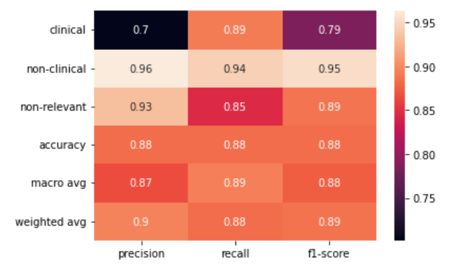
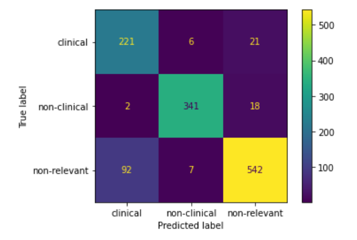

# DEBBIE Abstract Classifier

This component performs multiclass classification of abstracts to determine if they are relevant (either clinical or non-clinical studies) or not relevant to the field of biomaterials. We used the Transformers, the state-of-the-art of NLP, to train the DEBBIE_BioBERT model  capable of detecting relevant biomaterials abstracts.  

## Description  of the project

The DEBBIE_BioBERT model text-classification obtains an presicion of 0.92, a recall of 0.91 and an F1-score of 0.91. To achieve this result, we performed benchmarking between different pretrained models on biomedical data. The fine-tuning of the BioBERT (Bidirectional Encoder Representations from Transformers for Biomedical Text Mining) pretrained model obtained the best result. BioBERT is a domain-specific language representation model pre-trained on large-scale biomedical corpora. We made use of the BioBERT version pre-trained with PubMed.    

This component was developed in Python leveraging the HuggingFace ecosystem for the development of transformer models 
[https://huggingface.co/](https://huggingface.co/). 

DEBBIE_BioBERT is available at [https://huggingface.co/javicorvi/DEBBIE_BioBERT/](https://huggingface.co/javicorvi/DEBBIE_BioBERT/)

## Model development and performance

The DEBBIE_BioBERT has been fine-tuned with 3 collections:

- [gold standard biomaterials non-clinical collection](https://github.com/ProjectDebbie/gold_standard_set/blob/master/laboratory_gs_1213.txt)
- [gold standard biomaterials clinical collection](https://github.com/ProjectDebbie/gold_standard_set/blob/master/clinical_gs_1092.txt)
- [background set](https://github.com/ProjectDebbie/background_set). 

The folder classifier-dataset contains the test set that was used for validate the classifier.

The best model was selected after a benchmarking on different pre-trained biomedical models: [BioBert](https://huggingface.co/dmis-lab/biobert-v1.1), [Bio_ClinicalBERT](https://huggingface.co/emilyalsentzer/Bio_ClinicalBERT) and [BioDistilBERT-uncased](https://huggingface.co/nlpie/bio-distilbert-uncased).

The DEBBIE Abstract Classifier older version 3.00 was a logistic regression model with stochastic gradient descent optimization (SGDClassifier) using term frequency times inverse document frequency (TF-IDF). The old DEBBIE SGDClassifier model achieved an presicion of 0.90, a recall of 0.88 and an F1-score of 0.89. The new DEBBIE_BioBERT model achieved an presicion of 0.92, a recall of 0.91 and an F1-score of 0.91.

### Classification report

### Confusion Matrix

The performance results can be reproducible through the file debbie_abstract_classifier_performance.ypinb (jypiter notebook).
 
## Docker
projectdebbie/classifier:4.0.0

## Execution 

	python3 debbie_trained_classifier.py -i /in -o /out 
	#or in with docker
	docker run --rm -u $UID -v ${PWD}/input_output:/in:ro -v ${PWD}/nlp_preprocessing_output:/out:rw projectdebbie/classifier:version python3 /usr/src/app/debbie_trained_classifier.py -i /in -o /out -w /usr/src/app

Parameters:

-i input folder with plain text abstracts

-o output folder with relevant biomaterials abstracts in plain text 

-w work folder

## Actual Version: 4.0.0, 2023-03-10
## [Changelog](https://github.com/ProjectDebbie/Classifier/blob/master/CHANGELOG)

## Built With

* [scikit-learn library](https://scikit-learn.org)
* [Docker](https://www.docker.com/) - Docker Containers

## Authors

* **Javier Corvi** - **Osnat Hakimi** 

## License

This project is licensed under the GNU GENERAL PUBLIC LICENSE Version 3 - see the [LICENSE](LICENSE) file for details

## Funding
 This project has received funding from the European Union’s Horizon 2020 research and innovation programme under the Marie Sklodowska-Curie grant agreement No 751277
	
		

		
